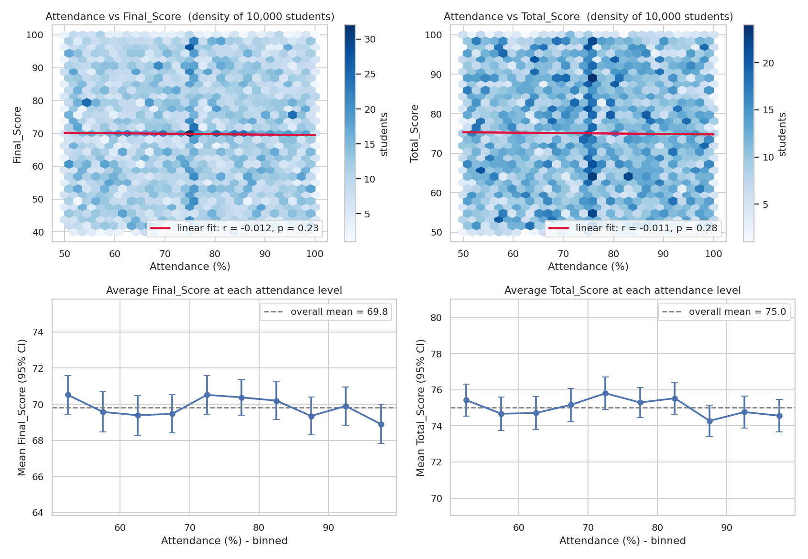
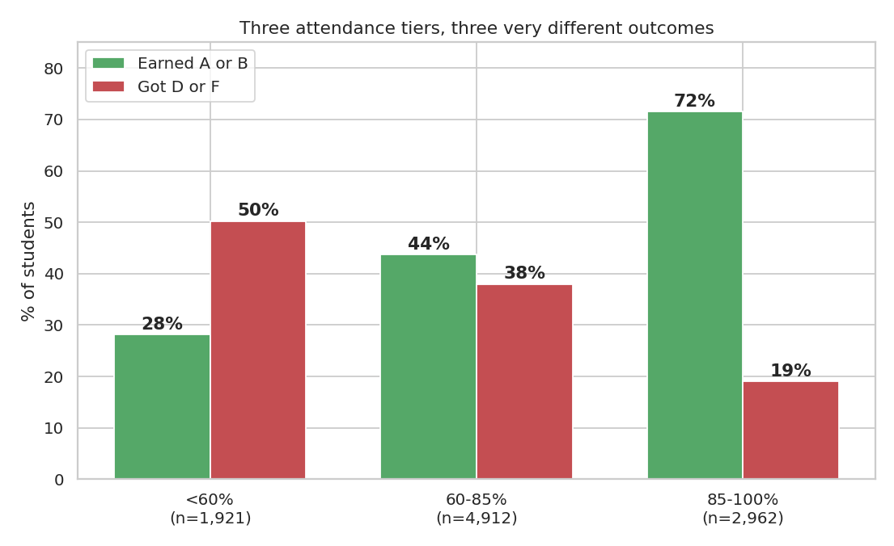
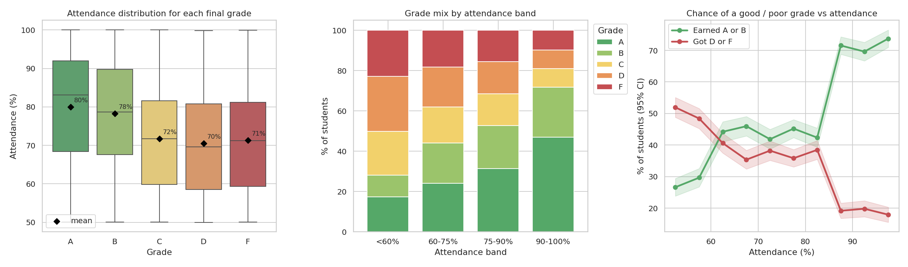
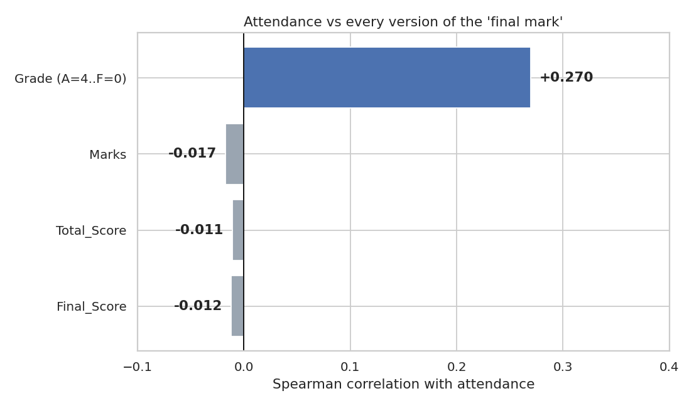
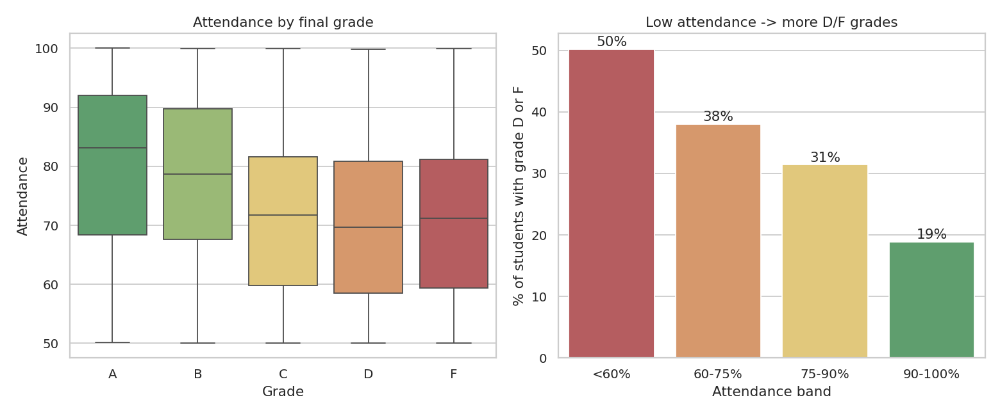
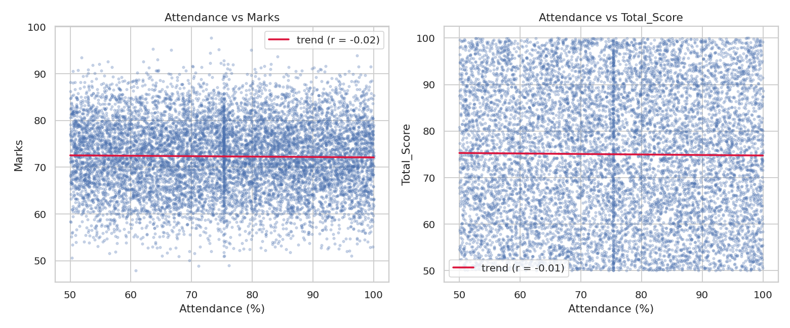
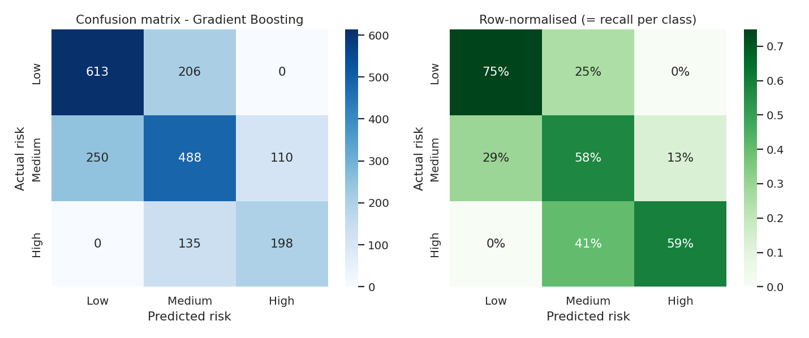

# 🎓 Student Academic-Risk Prediction

An end-to-end machine-learning project that identifies students who may need **academic intervention**, classifies them as **Low / Medium / High risk**, and automatically generates a per-student report with personalised recommendations.

**Dataset:** [Student Dataset (Kaggle)](https://www.kaggle.com/datasets/ganeshkumarofficial/student-dataset) – 10,030 raw rows, 21 columns.
**Stack:** Python · pandas · scikit-learn · matplotlib · seaborn · SciPy

```
Student: S1000 (Omar Williams)
Attendance: 52%
Marks: 68
Risk: HIGH

Recommendation:
Improve attendance and focus on upcoming assessments. Give extra practice to the midterm
material (current average 55). Meet an academic adviser this week to agree a support plan.
```

---

## 🔎 Main focus: attendance vs final mark

"Final mark" can mean three things here, so all three were tested ([full numbers](outputs/reports/attendance_analysis.txt)):

| Final-mark definition | Correlation with attendance | Verdict |
|---|---|---|
| Final-exam score (`Final_Score`) | Pearson r = −0.012 (p = 0.23) | **No relationship** |
| Overall score (`Total_Score`) | Pearson r = −0.011 (p = 0.28) | **No relationship** |
| Letter grade (A–F) | Spearman ρ = +0.27 (p ≈ 1e-166) | **Clear, significant relationship** |

**1. Numeric scores ignore attendance.** Students under 75 % attendance average 69.9 on the final exam; students at 75 % or more average 69.8 (Welch t-test p = 0.69). The trend line is flat and the binned averages stay inside the noise band.



**2. Letter grades do depend on attendance, and it is a step, not a straight line.** Outcomes are flat *inside* three tiers and jump *between* them, at about 60 % and 85 %. This is why a linear correlation on the scores misses it.

| Attendance tier | Students | Earned A or B | Got D or F |
|---|---|---|---|
| < 60 % | 1,921 | 28 % | **50 %** |
| 60 – 85 % | 4,912 | 44 % | 38 % |
| ≥ 85 % | 2,962 | **72 %** | 19 % |





**Interpretation.** Attendance clearly goes with the grade a student receives, but not with the marks that supposedly produce it. In real data, grades follow scores, so this mismatch suggests the dataset's grades were generated partly from attendance rather than from the scores. I report it as observed and make no causal claim.

---

## 1. Key findings (data exploration)

| Finding | Evidence |
|---|---|
| **Attendance and raw marks are essentially uncorrelated** | Pearson r = −0.02 (attendance vs weighted marks), r = −0.01 (vs `Total_Score`) |
| **But attendance strongly relates to the final grade** | Spearman ρ = +0.27 (p ≈ 1e-181). Mean attendance: A = 80 %, B = 78 %, C = 72 %, D = 71 %, F = 71 % |
| **Low attendance → more failures** | Share of D/F grades: **50 %** (<60 % attendance) → 38 % → 31 % → **19 %** (90–100 %) |
| `Total_Score` is not explained by any other column | R² ≈ 0.001 against the components; flat across grades (A = 74.6 … F = 75.2) |
| No difference by department, gender or test-prep course | Group means differ by < 1 point |




More plots: [distributions](outputs/figures/01_distributions.png) · [correlation heat-map](outputs/figures/04_correlation_heatmap.png) · full numbers in [`eda_summary.txt`](outputs/reports/eda_summary.txt).

> **Takeaway:** in this dataset **attendance is the one reliable early-warning signal**. Most other columns behave like independent noise, which strongly shapes the modelling choices below.

## 2. Data preprocessing

| Problem found | Fix |
|---|---|
| 30 duplicate students | Removed (kept first) → 10,000 unique students |
| ~200 missing values in 8 numeric columns (≈2 % each) | Median imputation (dropping rows would lose ~15 % of students) |
| Impossible values: attendance 135 % / −12 %, scores 145 / −8, age −3 / 87 | Set to missing, then imputed |
| `' FEMALE'`, `' MALE'`, `' engineering'`, `'BUSINESS'` | Stripped & normalised |
| Same department as `CS` / `Computer Science`, `Math` / `Mathematics` | Merged into 4 departments |
| `math_score` read as text (stray tab `'\t41'`) | Converted to numeric |

**Feature engineering:** `Marks` = weighted course-work average (midterm 25 %, final 30 %, assignments 15 %, quizzes 10 %, projects 20 %).

**Feature selection**
- Dropped identifiers / PII (ID, names, email).
- Dropped **`Grade` and `Total_Score`** to avoid target leakage – a grade doesn't exist until the semester ends, so it can't be used for *early* warning.
- Dropped **`Gender`** deliberately: a risk model must not flag students because of who they are. `Department` was dropped as EDA showed no difference.
- Ranked the remaining numeric candidates by Random-Forest importance on the **training split only** and kept those above the mean → **`Attendance`, `Marks`**.

## 3. Risk definition & model

The dataset has no "at-risk" column, so I defined one with a transparent **points system** (easy to explain to advisers; each point has a reason).

| Indicator | 0 points | 1 point | 2 points |
|---|---|---|---|
| Attendance | ≥ 75 % | 60 – 75 % | < 60 % |
| Marks (weighted) | ≥ 70 | 60 – 70 | < 60 |
| Final grade | A / B | C | D / F |

**Total 0–1 → 🟢 Low · 2–3 → 🟠 Medium · 4–6 → 🔴 High.**
Resulting split: Low 41 % · Medium 42 % · High 17 % (`outputs/figures/05_risk_overview.png`).

- **75 %** is the usual minimum-attendance rule; **60** is a near-failing mark.
- `Total_Score` is *not* used in the label because EDA showed it carries no information.
- The label uses `Grade`, but **the model never sees it** – it must predict risk from attendance and assessment marks alone, which is the real early-warning use case.

Four algorithms (Logistic Regression, Decision Tree, Random Forest, Gradient Boosting) plus a majority-class baseline were compared with 5-fold stratified CV on the 80 % training split; the best was scored **once** on the untouched 20 % test set.

| Model | CV Accuracy | CV Macro-F1 |
|---|---|---|
| **Gradient Boosting** | **0.654** | **0.645** |
| Random Forest | 0.623 | 0.619 |
| Decision Tree | 0.622 | 0.614 |
| Logistic Regression | 0.607 | 0.607 |
| Baseline (always "Medium") | 0.424 | 0.199 |

## 4. Evaluation (held-out test set, 2,000 students)

| Class | Precision | Recall | F1 | Support |
|---|---|---|---|---|
| Low | 0.710 | 0.748 | 0.729 | 819 |
| Medium | 0.589 | 0.575 | 0.582 | 848 |
| High | 0.643 | 0.595 | 0.618 | 333 |
| **Accuracy** | | | **0.649** | 2000 |
| **Macro avg** | 0.647 | 0.640 | 0.643 | |

|  | Pred. Low | Pred. Medium | Pred. High |
|---|---|---|---|
| **Actual Low** | 613 | 206 | **0** |
| **Actual Medium** | 250 | 488 | 110 |
| **Actual High** | **0** | 135 | 198 |



**How to read this**
- The model beats the baseline by a wide margin (0.65 vs 0.42 accuracy).
- **It never confuses Low with High** – every mistake is between neighbouring levels, the least harmful kind of error.
- It catches ~60 % of truly High-risk students; the rest are mostly flagged Medium, so they still get attention.
- Attendance dominates ([feature importance](outputs/figures/07_feature_importance.png)): shuffling it costs 0.28 macro-F1 vs 0.08 for marks.

### ⚠️ Honest limitations
Part of the label is a function of attendance and marks, so a model can partly "re-learn the rule". To check how well we can predict a **real outcome** instead, I trained models to predict *actual failure (grade D/F)* from every available feature:

| Predicting grade D/F | ROC-AUC (5-fold CV) |
|---|---|
| Attendance alone | 0.633 |
| All features, Logistic Regression | 0.631 |
| All features, Random Forest | 0.640 |

(0.5 = coin flip.) Predictive power for real outcomes is **modest, and attendance alone gives nearly all of it**. The data appears to be largely synthetic: scores are unrelated to grades, so no model – however complex – can do much better. The risk model is therefore best used as a **screening / prioritisation tool for advisers, not an automated decision-maker**. With real data (prior GPA, LMS activity, week-by-week attendance) I'd expect a large improvement.

## 5. Prediction & recommendation

The model decides the risk level; the recommendation is then generated from the student's own numbers (weakest assessment component, attendance, participation, risk level). Look up any student:

```bash
python predict_student.py S1000
```

## 6. Automated report (bonus)

`python main.py` writes a report for **all 10,000 students**, sorted highest-risk first:

| Student | Attendance | Risk | Recommendation |
|---|---|---|---|
| S1336 | 50.0 | High | Improve attendance. Give extra practice to final-exam preparation (current average 52). … Meet an academic adviser this week … |

- [`student_risk_report.csv`](outputs/reports/student_risk_report.csv) – full report
- [`student_risk_report.html`](outputs/reports/student_risk_report.html) – colour-coded view (top 200)
- [`high_risk_students.csv`](outputs/reports/high_risk_students.csv) – the intervention list

Report risk levels use **out-of-fold** predictions, so no student is scored by a model that was trained on them.

## 7. Run it yourself

```bash
git clone <your-repo-url> && cd student-risk-prediction
python -m venv .venv && .venv\Scripts\activate      # Windows  (macOS/Linux: source .venv/bin/activate)
pip install -r requirements.txt
python main.py                  # full pipeline (~1 min)
python predict_student.py S1000 # single-student prediction
```

## 8. Project structure

```
├── main.py                 # runs the whole pipeline, step by step
├── predict_student.py      # CLI: risk + recommendation for one student
├── requirements.txt
├── data/dcs_student_data.csv
├── src/
│   ├── config.py           # paths, valid ranges, risk thresholds (all "magic numbers")
│   ├── preprocessing.py    # cleaning + Marks feature
│   ├── eda.py              # statistics & figures
│   ├── attendance_analysis.py  # focused attendance vs final-mark analysis
│   ├── risk_labeling.py    # Low / Medium / High criteria
│   ├── modeling.py         # feature selection, model comparison, evaluation
│   └── recommendation.py   # recommendations + report generation
└── outputs/
    ├── figures/            # 11 plots
    ├── reports/            # CSV / HTML report, metrics, EDA summary, run log
    └── models/risk_model.joblib
```

## 9. Possible improvements
- Replace the rule-based label with real intervention outcomes (e.g. students who later dropped out or failed a retake).
- Add time-series features (attendance trend week by week) to warn *earlier*.
- Calibrate probabilities and tune the decision threshold to favour recall on High risk.
- Wrap the predictor in a small Streamlit dashboard for advisers.
